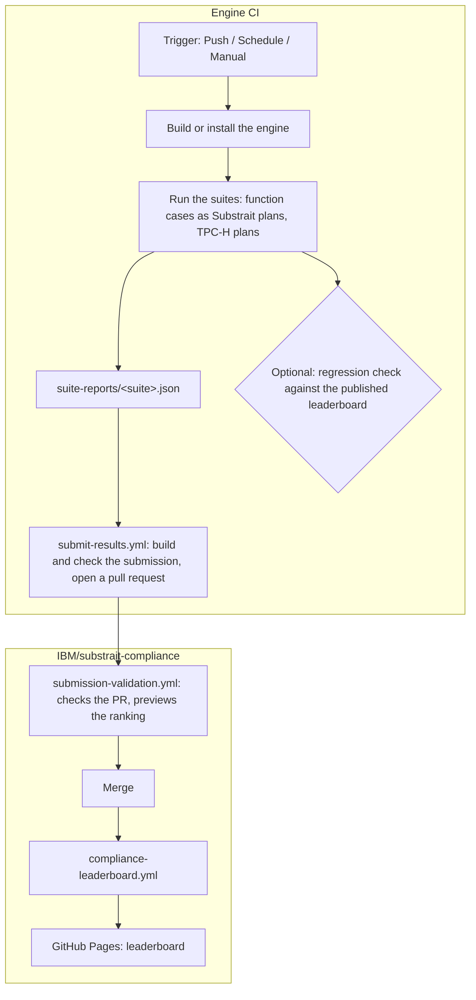
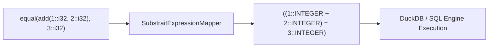

# Substrait Compliance CI/CD Workflow & Engine Integration Guide

This guide explains how database engine developers and integration teams can adopt, run, and automate the **Substrait Compliance Framework** within their Continuous Integration (CI) pipelines using GitHub Actions.

The framework provides an engine-agnostic compliance runner, standardized interfaces, test suites (TPC-H, TPC-DS, and Scalar/Aggregate Functions), and the public compliance leaderboard.

> **To put your engine on the leaderboard,** run the suites in your CI and submit the results by pull request. The reusable workflow `submit-results.yml` does it for you; see [submissions/README.md](../submissions/README.md). How the leaderboard is scored and published, for engines run in this repository and for submitted ones, is described in [COMPLIANCE_LEADERBOARD.md](COMPLIANCE_LEADERBOARD.md).

---

## Table of Contents

1. [Overview & Architecture](#overview--architecture)
2. [Workflow Pipeline Stages](#workflow-pipeline-stages)
3. [Implementing Compliance Interfaces](#implementing-compliance-interfaces)
   - [Java Interface](#java-interface)
   - [Python Interface](#python-interface)
   - [Rust Interface](#rust-interface)
   - [C++ Interface](#c-interface)
4. [Substrait Operator & Type Mapping](#substrait-operator--type-mapping)
5. [Local CLI Commands](#local-cli-commands)
   - [Running Python Compliance Runner](#running-python-compliance-runner)
   - [Running Java Compliance Runner (DuckDB Example)](#running-java-compliance-runner-duckdb-example)
   - [Previewing the Leaderboard Locally](#previewing-the-leaderboard-locally)
5. [GitHub Actions CI Setup](#github-actions-ci-setup)
   - [Workflow Configuration File](#workflow-configuration-file)
   - [Submitting to the Leaderboard](#submitting-to-the-leaderboard)
   - [Regression Checks](#regression-checks)
6. [Adapting for Other Engines](#adapting-for-other-engines)
   - [DataFusion (Rust / Python)](#datafusion-rust--python)
   - [Velox / Native C++ Engines](#velox--native-c-engines)
   - [PostgreSQL / Trino (JDBC Engines)](#postgresql--trino-jdbc-engines)
7. [Troubleshooting & Best Practices](#troubleshooting--best-practices)

---

## Overview & Architecture

The compliance workflow provides a decentralized mechanism for query engines to validate their Substrait implementation and publish verifiable compliance scores.



Engines run by this repository's own CI (DuckDB, DataFusion) reach the same leaderboard through their workflows' artifacts; see [COMPLIANCE_LEADERBOARD.md](COMPLIANCE_LEADERBOARD.md).

---

## Workflow Pipeline Stages

The reference workflow [`.github/workflows/duckdb-compliance.yml`](../.github/workflows/duckdb-compliance.yml) runs DuckDB in this repository's CI:

| Stage | Job Name | Purpose | Output / Artifact |
|---|---|---|---|
| **1** | `build-framework` | Builds the Java SDK fat JAR and packages the test suites. | `compliance-assets` |
| **2** | `run-compliance` | Runs TPC-H in both plan encodings (Java runner), validates the function suite, and runs it as Substrait plans (scored) and as SQL (reference), plus the legacy suite. It combines the reports into DuckDB's leaderboard entry (`combine_engine_reports.py --source ci`) and runs the regression check against the last published entry. | `duckdb-compliance-reports`, `duckdb-leaderboard-report` |
| **3** | `leaderboard-preview` | Renders the entry as the leaderboard would show it. | job summary, `leaderboard-preview` |
| **4** | `summary` | Overall, Functions and Queries scores, and per-suite results. | job summary |

Publishing is a separate workflow, [`compliance-leaderboard.yml`](../.github/workflows/compliance-leaderboard.yml), which takes the entry of the latest successful run on `main`. [`datafusion-compliance.yml`](../.github/workflows/datafusion-compliance.yml) does the same for DataFusion with the Python runners only.

---

## Implementing Compliance Interfaces

To test an engine against the compliance suites, implement the standardized `ComplianceEngine` interface in your language of choice.

### Java Interface

Implement [`io.substrait.compliance.ComplianceEngine`](../sdk/java/src/main/java/io/substrait/compliance/ComplianceEngine.java:18):

```java
package io.substrait.example;

import io.substrait.compliance.ComplianceEngine;
import io.substrait.compliance.TestResult;
import java.util.Map;

public class MyDatabaseComplianceEngine implements ComplianceEngine {
    
    @Override
    public String getEngineName() {
        return "MyDatabase";
    }

    @Override
    public String getEngineVersion() {
        return "1.0.0";
    }

    @Override
    public void loadTable(String tableName, String schemaSql, String csvPath) throws Exception {
        // Load input CSV into temporary database table
    }

    @Override
    public TestResult executePlan(byte[] planBytes, String expectedCsvPath) {
        // Execute binary Substrait plan and compare results
        return TestResult.passed("test_case", 100);
    }

    @Override
    public TestResult executePlanJson(String planJson, String expectedCsvPath) {
        // Execute JSON Substrait plan
        return TestResult.passed("test_case", 100);
    }
}
```

### Python Interface

Implement [`substrait_compliance.engine.ComplianceEngine`](../sdk/python/substrait_compliance/engine.py:42):

```python
from substrait_compliance.engine import ComplianceEngine, ExecutionResult
import duckdb

class DuckDBComplianceEngine(ComplianceEngine):
    def __init__(self):
        self.con = duckdb.connect()
        self.con.install_extension("substrait")
        self.con.load_extension("substrait")

    def name(self) -> str:
        return "DuckDB"

    def version(self) -> str:
        return "1.2.0"

    def register_table(self, name: str, schema: dict, data_file: str) -> None:
        self.con.execute(f"CREATE TABLE {name} AS SELECT * FROM read_csv_auto('{data_file}')")

    def execute_plan(self, plan_bytes: bytes) -> ExecutionResult:
        df = self.con.execute("SELECT * FROM from_substrait(?)", [plan_bytes]).fetchdf()
        return ExecutionResult(data=df.to_dict(orient="records"))
```

### Rust Interface

Implement `substrait_compliance::ComplianceEngine`:

```rust
use substrait_compliance::{ComplianceEngine, ExecutionResult, TestResult};

pub struct DataFusionEngine {
    ctx: datafusion::prelude::SessionContext,
}

#[async_trait::async_trait]
impl ComplianceEngine for DataFusionEngine {
    fn engine_name(&self) -> &str {
        "DataFusion"
    }

    fn engine_version(&self) -> &str {
        "38.0.0"
    }

    async fn execute_plan(&self, plan_bytes: &[u8]) -> Result<ExecutionResult, Box<dyn std::error::Error>> {
        // Execute plan in DataFusion session context
        Ok(ExecutionResult::default())
    }
}
```

---

## Substrait Operator & Type Mapping

Two function-test formats are supported, detected per file:

- **Current upstream format** — [`test-suites/functions-substrait-0.107`](../test-suites/functions-substrait-0.107/README.md).
  Files are parsed with the Substrait project's own parser
  ([`substrait_compliance.function_cases`](../sdk/python/substrait_compliance/function_cases.py)), validated
  against the extension YAMLs by [`scripts/validate_function_tests.py`](../scripts/validate_function_tests.py), and
  translated from the parsed values into DuckDB or DataFusion SQL by [`scripts/function_sql.py`](../scripts/function_sql.py)
  (scalar, aggregate and window cases). DataFusion runs in
  [`datafusion-compliance.yml`](../.github/workflows/datafusion-compliance.yml).
- **Legacy format** — [`test-suites/functions`](../test-suites/functions/README.md), mapped by the regex-based
  mapper described below. This suite has been replaced by the one above; it still runs and is shown
  on the leaderboard as `functions-legacy`, but is not scored.

Substrait Function Test files (`.test`) declare functional AST signatures rather than SQL statements. For the legacy format, the framework includes [`SubstraitExpressionMapper`](../sdk/python/substrait_compliance/expression_mapper.py:10) to recursively map Substrait operators, types, and functions to database-executable SQL expressions:



### Supported Mapping Categories

| Category | Substrait `.test` Syntax | Mapped Engine SQL Syntax |
|---|---|---|
| **Binary Operators** | `equal(a, b)`, `add(a, b)`, `lt(a, b)` | `(a = b)`, `(a + b)`, `(a < b)` |
| **Logic & Conditionals** | `case_when(c, t, e)`, `between(x, a, b)` | `CASE WHEN c THEN t ELSE e END`, `x BETWEEN a AND b` |
| **Unary & Nulls** | `negate(x)`, `not(x)`, `is_null(x)` | `(-x)`, `NOT(x)`, `x IS NULL` |
| **Type Casts** | `try_cast('42'::str, i32)` | `TRY_CAST('42'::VARCHAR AS INTEGER)` |
| **Data Types** | `::i8`, `::i32`, `::fp64`, `::dec<38,0>` | `::TINYINT`, `::INTEGER`, `::DOUBLE`, `::DECIMAL(38,0)` |
| **Special Floats** | `inf::fp64`, `-inf::fp64`, `nan::fp64` | `'inf'::DOUBLE`, `'-inf'::DOUBLE`, `'nan'::DOUBLE` |
| **Structs & Arrays** | `struct_construct('x', 1::i32, 'y', 2::i32)` | `struct_pack("x" := 1::INTEGER, "y" := 2::INTEGER)` |
| **Array Operations** | `array_contains([1, 2, 3]::list<i32>, 2::i32)` | `list_contains([1, 2, 3]::INTEGER[], 2::INTEGER)` |

### Python Usage Example

```python
from substrait_compliance.expression_mapper import SubstraitExpressionMapper

# Map functional test expression to SQL
sql_expr = SubstraitExpressionMapper.map_expression("equal(add(10::i32, 20::i32), 30::i32)")
# Output: "((10::INTEGER + 20::INTEGER) = 30::INTEGER)"

# Clean expected result type annotations
expected_sql = SubstraitExpressionMapper.clean_types("30::i32")
# Output: "30::INTEGER"
```

---

## Local CLI Commands

### Running Python Compliance Runner

Run compliance validation on test suites locally:

```bash
# 1. Install SDK in editable mode
pip install -e ./sdk/python

# 2. Run Python test suites
pytest sdk/python/tests -v

# 3. Run Function Test Suite Demo
python3 demo/runner/function_test_demo.py --report-file reports/function-compliance.json

# 4. Run TPC-H Suite against DuckDB
python3 -c "
from substrait_compliance.loader import TestSuiteLoader
from substrait_compliance.runner import ComplianceRunner
from demo.runner.function_test_demo import DuckDBEngine

loader = TestSuiteLoader('test-suites/tpch')
suite = loader.load_suite('test-suites/tpch/test_suite.yaml')
print(f'Loaded suite with {len(suite.test_cases)} queries')
"
```

### Running Java Compliance Runner (DuckDB Example)

Build and run the Java reference implementation:

```bash
# 1. Build Java SDK Fat JAR
cd sdk/java
./gradlew shadowJar
cd ../..

# 2. Run DuckDB Java Compliance Runner (Dry Run / Validation)
java -cp "libs/substrait-compliance-all.jar:examples/duckdb-java/target/classes" \
  io.substrait.example.DuckDBComplianceExample \
  --test-suites test-suites \
  --output-report reports/duckdb-compliance-report.json \
  --dry-run

# 3. Run Live Execution with DuckDB JDBC
java -Dduckdb.native=true \
  -cp "libs/substrait-compliance-all.jar:examples/duckdb-java/target/classes:~/.m2/repository/org/duckdb/duckdb_jdbc/0.10.0/duckdb_jdbc-0.10.0.jar" \
  io.substrait.example.DuckDBComplianceExample \
  --test-suites test-suites \
  --output-report reports/duckdb-compliance-report.json
```

### Previewing the Leaderboard Locally

Combine one engine's suite reports into a leaderboard entry, then render the leaderboard from entries:

```bash
python3 scripts/combine_engine_reports.py --engine MyEngine --consumer "my-substrait 1.0" \
  --functions functions-substrait-0.107=suite-reports/functions-substrait-0.107.json \
  --queries tpch=suite-reports/tpch.json \
  --reference functions-substrait-0.107-sql=suite-reports/functions-substrait-0.107-sql.json \
  --output entries/myengine.json
python3 scripts/generate_leaderboard.py --input entries/ --output preview/leaderboard.md --format all
# preview/leaderboard.md, leaderboard.json and leaderboard.html (the page published on GitHub Pages)
```

The public leaderboard is generated only by this repository's `compliance-leaderboard.yml`; do not commit leaderboard files. See [COMPLIANCE_LEADERBOARD.md](COMPLIANCE_LEADERBOARD.md) for how engines are scored.

---

## GitHub Actions CI Setup

### Workflow Configuration File

Create `.github/workflows/compliance.yml` in your repository. It runs the suites from a checkout of this repository and keeps one report per suite. Your engine is a class of your own (`--engine package.module:Class`); see [submissions/README.md](../submissions/README.md#your-engine-class).

```yaml
name: Substrait Compliance

on:
  schedule:
    - cron: '0 2 * * 1' # Weekly Monday run
  workflow_dispatch:

permissions:
  contents: read

jobs:
  run-compliance:
    runs-on: ubuntu-latest
    steps:
      - uses: actions/checkout@v4              # your engine and its compliance adapter

      - uses: actions/checkout@v4              # the suites and runners, from main
        with:
          repository: IBM/substrait-compliance
          path: compliance

      - uses: actions/setup-python@v5
        with:
          python-version: '3.11'

      - name: Install the framework and the engine
        run: |
          pip install -e compliance/sdk/python "substrait-extensions==0.107.0" "substrait-protobuf==0.107.0"
          pip install my-database-engine

      - name: Run the suites
        env:
          PYTHONPATH: ${{ github.workspace }}/compliance-adapter   # where my_engine.py lives
        run: |
          cd compliance
          mkdir -p ../suite-reports
          python scripts/run_function_compliance.py --engine my_engine:MyFunctionEngine --mode plan \
            --suites-dir test-suites/functions-substrait-0.107/upstream \
            --suite-name functions-substrait-0.107 --output ../suite-reports/functions-substrait-0.107.json
          python scripts/run_plan_compliance.py --engine my_engine:MyPlanEngine \
            --test-suite test-suites/tpch/metadata.yaml --output ../suite-reports/tpch.json

      - uses: actions/upload-artifact@v4
        with:
          name: compliance-suite-reports
          path: suite-reports/
```

### Submitting to the Leaderboard

Add a job that calls the reusable workflow. It builds and checks the submission, then opens the pull request:

```yaml
  submit:
    needs: run-compliance
    if: github.ref == 'refs/heads/main'
    uses: IBM/substrait-compliance/.github/workflows/submit-results.yml@<commit-sha>   # pin it
    with:
      engine: MyEngine
      engine-version: 1.0.0
      consumer: my-substrait 1.0.0
      reports-artifact: compliance-suite-reports
      # dry-run: true   # build and check only, no pull request
    secrets:
      submission-token: ${{ secrets.SUBSTRAIT_COMPLIANCE_TOKEN }}
```

Use a token from a dedicated bot account; [submissions/README.md](../submissions/README.md) has the details and the rules a submission must meet.

### Regression Checks

A fixed minimum pass rate is not used. Engines start from very different places, so what CI should catch is a result getting worse. To fail your own CI on a drop, compare your new entry with your engine's entry in the published [`leaderboard.json`](https://ibm.github.io/substrait-compliance/leaderboard.json):

```bash
curl -sf https://ibm.github.io/substrait-compliance/leaderboard.json \
  | jq '.engines[] | select(.engineName == "MyEngine")' > baseline.json
python3 compliance/scripts/check_compliance_regression.py \
  --current entries/myengine.json --baseline baseline.json --max-drop 1.0
```

The check compares Overall and each category, and passes with a notice when there is nothing to compare yet. This repository's own workflows use it with their last successful run's entry; see [COMPLIANCE_LEADERBOARD.md](COMPLIANCE_LEADERBOARD.md#the-regression-check).

---

## Adapting for Other Engines

### DataFusion (Rust / Python)
- Use `datafusion-substrait` crate or `pydatafusion` Python bindings.
- Load TPC-H CSV files into memory tables via `ctx.register_csv(...)`.
- Pass binary plans to `datafusion_substrait::logical_plan::consumer::from_substrait_plan`.

### Velox / Native C++ Engines
- Compile Velox with Substrait conversion support enabled.
- Link against `substrait_compliance.a` or use the C++ Runner to process `.bin` plans.
- Register input vectors from CSV and evaluate `exec::Task`.

### PostgreSQL / Trino (JDBC Engines)
- Implement `ComplianceEngine` using JDBC driver connections.
- Use engine-specific Substrait extensions/functions (e.g. `pg_substrait` or Trino Substrait gateway).

---

## Troubleshooting & Best Practices

1. **Case-Insensitive Column Matching:**
   Different SQL engines emit varying casing for result column headers (e.g., `TOTAL_REVENUE` vs `total_revenue`). The framework runner automatically performs case-insensitive header matching while preserving data column order.

2. **Floating Point and Numeric Precision:**
   Comparing double/decimal calculations across engines can produce tiny rounding differences (e.g., `12.340001` vs `12.34`). The framework runner normalizes numeric types within configurable epsilon tolerances.

3. **Substrait Version Compatibility:**
   Ensure the engine's Substrait consumer supports the extension plan version in `test-suites/`. If the engine encounters unsupported operators or expression types, the runner catches the error and marks the individual test as failed without aborting the entire suite.
