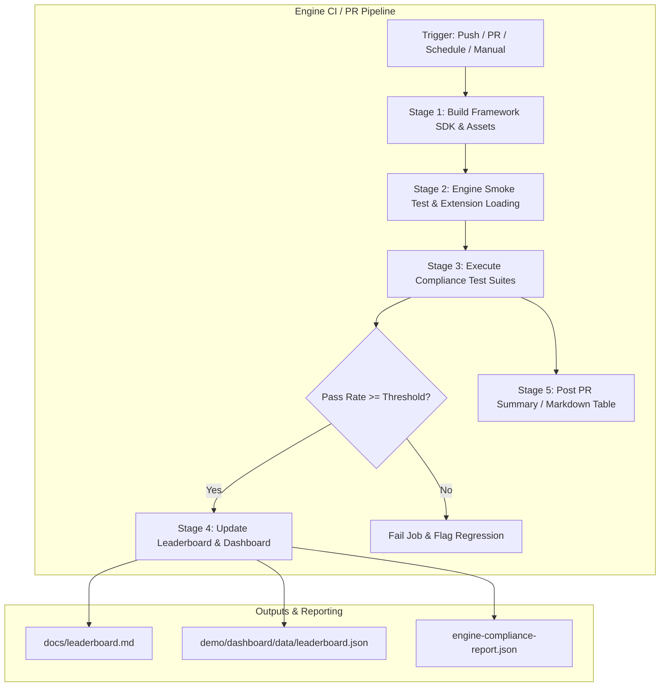
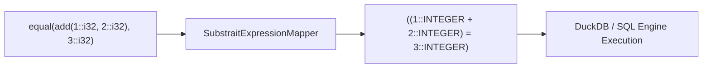

# Substrait Compliance CI/CD Workflow & Engine Integration Guide

This guide explains how database engine developers and integration teams can adopt, run, and automate the **Substrait Compliance Framework** within their Continuous Integration (CI) pipelines using GitHub Actions.

The framework provides an engine-agnostic compliance runner, standardized interfaces, test suites (TPC-H, TPC-DS, and Scalar/Aggregate Functions), and automated dashboard/leaderboard generators.

---

## Table of Contents

1. [Overview & Architecture](#overview--architecture)
2. [Workflow Pipeline Stages](#workflow-pipeline-stages)
3. [Implementing Compliance Interfaces](#implementing-compliance-interfaces)
   - [Java Interface](#java-interface)
   - [Python Interface](#python-interface)
   - [Rust Interface](#rust-interface)
   - [C++ Interface](#c-interface)
4. [Substrait Operator & Type Mapping](#substrait-operator--type-mapping)
5. [Local CLI Commands](#local-cli-commands)
   - [Running Python Compliance Runner](#running-python-compliance-runner)
   - [Running Java Compliance Runner (DuckDB Example)](#running-java-compliance-runner-duckdb-example)
   - [Generating Leaderboards & Dashboard Data](#generating-leaderboards--dashboard-data)
5. [GitHub Actions CI Setup](#github-actions-ci-setup)
   - [Workflow Configuration File](#workflow-configuration-file)
   - [Workflow Dispatch Parameters](#workflow-dispatch-parameters)
   - [Enforcing Compliance Thresholds & Regressions](#enforcing-compliance-thresholds--regressions)
6. [Adapting for Other Engines](#adapting-for-other-engines)
   - [DataFusion (Rust / Python)](#datafusion-rust--python)
   - [Velox / Native C++ Engines](#velox--native-c-engines)
   - [PostgreSQL / Trino (JDBC Engines)](#postgresql--trino-jdbc-engines)
7. [Troubleshooting & Best Practices](#troubleshooting--best-practices)

---

## Overview & Architecture

The compliance workflow provides a decentralized mechanism for query engines to validate their Substrait implementation and publish verifiable compliance scores.



---

## Workflow Pipeline Stages

The reference workflow [`.github/workflows/duckdb-compliance.yml`](../.github/workflows/duckdb-compliance.yml) executes five automated stages:

| Stage | Job Name | Purpose | Output / Artifact |
|---|---|---|---|
| **1** | `build-framework` | Compiles the Java SDK fat JAR and packages standard test suites. | `compliance-assets` (Fat JAR + Test Suites) |
| **2** | `duckdb-smoke-test` | Verifies JDBC connectivity, driver loading, and native extension availability. | Console verification |
| **3** | `run-compliance` | Runs real query execution via the engine's `ComplianceEngine` implementation and type-aware comparator. | `duckdb-compliance-report.json` |
| **4** | `update-dashboard` | Runs `scripts/generate_leaderboard.py` to regenerate leaderboard Markdown and JSON for the dashboard. | `docs/leaderboard.md`, `demo/dashboard/data/leaderboard.json` |
| **5** | `compliance-summary` | Parses results and generates a rich GitHub Actions Step Summary and PR comment. | GitHub Actions Job Summary |

---

## Implementing Compliance Interfaces

To test an engine against the compliance suites, implement the standardized `ComplianceEngine` interface in your language of choice.

### Java Interface

Implement [`io.substrait.compliance.ComplianceEngine`](../sdk/java/src/main/java/io/substrait/compliance/ComplianceEngine.java:18):

```java
package io.substrait.example;

import io.substrait.compliance.ComplianceEngine;
import io.substrait.compliance.TestResult;
import java.util.Map;

public class MyDatabaseComplianceEngine implements ComplianceEngine {
    
    @Override
    public String getEngineName() {
        return "MyDatabase";
    }

    @Override
    public String getEngineVersion() {
        return "1.0.0";
    }

    @Override
    public void loadTable(String tableName, String schemaSql, String csvPath) throws Exception {
        // Load input CSV into temporary database table
    }

    @Override
    public TestResult executePlan(byte[] planBytes, String expectedCsvPath) {
        // Execute binary Substrait plan and compare results
        return TestResult.passed("test_case", 100);
    }

    @Override
    public TestResult executePlanJson(String planJson, String expectedCsvPath) {
        // Execute JSON Substrait plan
        return TestResult.passed("test_case", 100);
    }
}
```

### Python Interface

Implement [`substrait_compliance.engine.ComplianceEngine`](../sdk/python/substrait_compliance/engine.py:42):

```python
from substrait_compliance.engine import ComplianceEngine, ExecutionResult
import duckdb

class DuckDBComplianceEngine(ComplianceEngine):
    def __init__(self):
        self.con = duckdb.connect()
        self.con.install_extension("substrait")
        self.con.load_extension("substrait")

    def name(self) -> str:
        return "DuckDB"

    def version(self) -> str:
        return "1.2.0"

    def register_table(self, name: str, schema: dict, data_file: str) -> None:
        self.con.execute(f"CREATE TABLE {name} AS SELECT * FROM read_csv_auto('{data_file}')")

    def execute_plan(self, plan_bytes: bytes) -> ExecutionResult:
        df = self.con.execute("SELECT * FROM from_substrait(?)", [plan_bytes]).fetchdf()
        return ExecutionResult(data=df.to_dict(orient="records"))
```

### Rust Interface

Implement `substrait_compliance::ComplianceEngine`:

```rust
use substrait_compliance::{ComplianceEngine, ExecutionResult, TestResult};

pub struct DataFusionEngine {
    ctx: datafusion::prelude::SessionContext,
}

#[async_trait::async_trait]
impl ComplianceEngine for DataFusionEngine {
    fn engine_name(&self) -> &str {
        "DataFusion"
    }

    fn engine_version(&self) -> &str {
        "38.0.0"
    }

    async fn execute_plan(&self, plan_bytes: &[u8]) -> Result<ExecutionResult, Box<dyn std::error::Error>> {
        // Execute plan in DataFusion session context
        Ok(ExecutionResult::default())
    }
}
```

---

## Substrait Operator & Type Mapping

Substrait Function Test files (`.test`) declare functional AST signatures rather than SQL statements. The framework includes [`SubstraitExpressionMapper`](../sdk/python/substrait_compliance/expression_mapper.py:10) to recursively map Substrait operators, types, and functions to database-executable SQL expressions:



### Supported Mapping Categories

| Category | Substrait `.test` Syntax | Mapped Engine SQL Syntax |
|---|---|---|
| **Binary Operators** | `equal(a, b)`, `add(a, b)`, `lt(a, b)` | `(a = b)`, `(a + b)`, `(a < b)` |
| **Logic & Conditionals** | `case_when(c, t, e)`, `between(x, a, b)` | `CASE WHEN c THEN t ELSE e END`, `x BETWEEN a AND b` |
| **Unary & Nulls** | `negate(x)`, `not(x)`, `is_null(x)` | `(-x)`, `NOT(x)`, `x IS NULL` |
| **Type Casts** | `try_cast('42'::str, i32)` | `TRY_CAST('42'::VARCHAR AS INTEGER)` |
| **Data Types** | `::i8`, `::i32`, `::fp64`, `::dec<38,0>` | `::TINYINT`, `::INTEGER`, `::DOUBLE`, `::DECIMAL(38,0)` |
| **Special Floats** | `inf::fp64`, `-inf::fp64`, `nan::fp64` | `'inf'::DOUBLE`, `'-inf'::DOUBLE`, `'nan'::DOUBLE` |
| **Structs & Arrays** | `struct_construct('x', 1::i32, 'y', 2::i32)` | `struct_pack("x" := 1::INTEGER, "y" := 2::INTEGER)` |
| **Array Operations** | `array_contains([1, 2, 3]::list<i32>, 2::i32)` | `list_contains([1, 2, 3]::INTEGER[], 2::INTEGER)` |

### Python Usage Example

```python
from substrait_compliance.expression_mapper import SubstraitExpressionMapper

# Map functional test expression to SQL
sql_expr = SubstraitExpressionMapper.map_expression("equal(add(10::i32, 20::i32), 30::i32)")
# Output: "((10::INTEGER + 20::INTEGER) = 30::INTEGER)"

# Clean expected result type annotations
expected_sql = SubstraitExpressionMapper.clean_types("30::i32")
# Output: "30::INTEGER"
```

---

## Local CLI Commands

### Running Python Compliance Runner

Run compliance validation on test suites locally:

```bash
# 1. Install SDK in editable mode
pip install -e ./sdk/python

# 2. Run Python test suites
pytest sdk/python/tests -v

# 3. Run Function Test Suite Demo
python3 demo/runner/function_test_demo.py --report-file reports/function-compliance.json

# 4. Run TPC-H Suite against DuckDB
python3 -c "
from substrait_compliance.loader import TestSuiteLoader
from substrait_compliance.runner import ComplianceRunner
from demo.runner.function_test_demo import DuckDBEngine

loader = TestSuiteLoader('test-suites/tpch')
suite = loader.load_suite('test-suites/tpch/test_suite.yaml')
print(f'Loaded suite with {len(suite.test_cases)} queries')
"
```

### Running Java Compliance Runner (DuckDB Example)

Build and run the Java reference implementation:

```bash
# 1. Build Java SDK Fat JAR
cd sdk/java
./gradlew shadowJar
cd ../..

# 2. Run DuckDB Java Compliance Runner (Dry Run / Validation)
java -cp "libs/substrait-compliance-all.jar:examples/duckdb-java/target/classes" \
  io.substrait.example.DuckDBComplianceExample \
  --test-suites test-suites \
  --output-report reports/duckdb-compliance-report.json \
  --dry-run

# 3. Run Live Execution with DuckDB JDBC
java -Dduckdb.native=true \
  -cp "libs/substrait-compliance-all.jar:examples/duckdb-java/target/classes:~/.m2/repository/org/duckdb/duckdb_jdbc/0.10.0/duckdb_jdbc-0.10.0.jar" \
  io.substrait.example.DuckDBComplianceExample \
  --test-suites test-suites \
  --output-report reports/duckdb-compliance-report.json
```

### Generating Leaderboards & Dashboard Data

Aggregate multiple engine compliance reports into Markdown and Dashboard JSON:

```bash
# Aggregate all JSON reports in reports/ directory
python3 scripts/generate_leaderboard.py \
  --input reports/ \
  --output docs/leaderboard \
  --format both

# Outputs generated:
#  - docs/leaderboard.md   (Markdown table for documentation/PR)
#  - docs/leaderboard.json (JSON data for dashboard)
```

---

## GitHub Actions CI Setup

### Workflow Configuration File

Create `.github/workflows/compliance.yml` in your repository:

```yaml
name: Substrait Compliance CI

on:
  push:
    branches: [ main, develop ]
  pull_request:
    branches: [ main, develop ]
  schedule:
    - cron: '0 2 * * 1' # Weekly Monday run
  workflow_dispatch:
    inputs:
      compliance_threshold:
        description: 'Minimum required pass rate percentage'
        required: false
        default: '80'
      engine_name:
        description: 'Engine Name'
        required: false
        default: 'MyEngine'

env:
  ENGINE_NAME: ${{ github.event.inputs.engine_name || 'MyEngine' }}
  COMPLIANCE_THRESHOLD: ${{ github.event.inputs.compliance_threshold || 80 }}

jobs:
  run-compliance:
    runs-on: ubuntu-latest
    steps:
      - uses: actions/checkout@v4

      - name: Set up Python
        uses: actions/setup-python@v5
        with:
          python-version: '3.11'

      - name: Install Framework & Engine
        run: |
          pip install -e sdk/python
          pip install my-database-engine

      - name: Execute Compliance Suite
        run: |
          mkdir -p reports
          python3 run_engine_compliance.py \
            --test-suites test-suites \
            --output reports/${{ env.ENGINE_NAME }}-report.json

      - name: Validate Compliance Threshold
        run: |
          python3 -c "
          import json, sys
          with open('reports/${{ env.ENGINE_NAME }}-report.json') as f:
              data = json.load(f)
          pass_rate = data.get('passRate', data.get('overallPassRate', 0))
          threshold = float('${{ env.COMPLIANCE_THRESHOLD }}')
          print(f'Compliance Pass Rate: {pass_rate:.1f}% (Threshold: {threshold}%)')
          if pass_rate < threshold:
              print(f'❌ Pass rate below threshold!')
              sys.exit(1)
          print('✅ Compliance threshold met!')
          "

      - name: Update Leaderboard
        if: github.ref == 'refs/heads/main'
        run: |
          python3 scripts/generate_leaderboard.py \
            --input reports/ \
            --output docs/leaderboard \
            --format both
```

### Workflow Dispatch Parameters

Teams can trigger ad-hoc compliance tests via the GitHub Actions UI:

| Parameter | Default | Description |
|---|---|---|
| `compliance_threshold` | `60` | Minimum pass rate required before CI fails. |
| `engine_name` | `DuckDB` | Target engine identifier for reporting. |
| `engine_version` | `0.10.0` | Target engine release version. |

---

## Adapting for Other Engines

### DataFusion (Rust / Python)
- Use `datafusion-substrait` crate or `pydatafusion` Python bindings.
- Load TPC-H CSV files into memory tables via `ctx.register_csv(...)`.
- Pass binary plans to `datafusion_substrait::logical_plan::consumer::from_substrait_plan`.

### Velox / Native C++ Engines
- Compile Velox with Substrait conversion support enabled.
- Link against `substrait_compliance.a` or use the C++ Runner to process `.bin` plans.
- Register input vectors from CSV and evaluate `exec::Task`.

### PostgreSQL / Trino (JDBC Engines)
- Implement `ComplianceEngine` using JDBC driver connections.
- Use engine-specific Substrait extensions/functions (e.g. `pg_substrait` or Trino Substrait gateway).

---

## Troubleshooting & Best Practices

1. **Case-Insensitive Column Matching:**
   Different SQL engines emit varying casing for result column headers (e.g., `TOTAL_REVENUE` vs `total_revenue`). The framework runner automatically performs case-insensitive header matching while preserving data column order.

2. **Floating Point and Numeric Precision:**
   Comparing double/decimal calculations across engines can produce tiny rounding differences (e.g., `12.340001` vs `12.34`). The framework runner normalizes numeric types within configurable epsilon tolerances.

3. **Substrait Version Compatibility:**
   Ensure the engine's Substrait consumer supports the extension plan version in `test-suites/`. If the engine encounters unsupported operators or expression types, the runner catches the error and marks the individual test as failed without aborting the entire suite.
