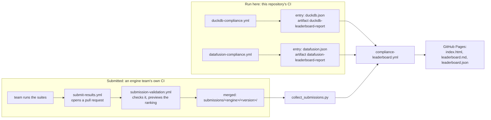

# How the compliance leaderboard works

The public leaderboard is at **https://ibm.github.io/substrait-compliance/** (data:
[`leaderboard.json`](https://ibm.github.io/substrait-compliance/leaderboard.json)). This page
explains how results reach it and how they are scored, for maintainers of this repository
and for engine teams.

- **Engine teams** who want to appear on it: [submissions/README.md](../submissions/README.md)
  is the step-by-step guide.
- **How cases pass, fail or are skipped:** [the function suite's README](../test-suites/functions-substrait-0.107/README.md)
  and [test-suites/tpch](../test-suites/tpch/README.md).

## Where results come from

An engine reaches the leaderboard in one of two ways. Both produce the same **leaderboard
entry** and are scored by the same code.



| | Run here | Submitted |
|---|---|---|
| Engines | DuckDB, DataFusion (`reservedEngineNames` in [`test-suites/registry.json`](../test-suites/registry.json)) | any other engine |
| Who runs the suites | this repository's workflows | the engine team, in their CI |
| How results arrive | an artifact of the latest successful run on `main` | a merged pull request under `submissions/` |
| Checks | the regression check in the workflow | the submission check on the pull request |
| Shown as | **Run here**, linked to the workflow run | **Submitted**, linked to the team's run |

## How engines are scored

Each engine has two scored **categories**:

| Category | Suite | What it measures |
|---|---|---|
| **Functions** | `functions-substrait-0.107` (the Substrait project's 1,315 function cases), run as Substrait plans | how many functions the engine's Substrait consumer runs correctly |
| **Queries** | `tpch` (22 TPC-H plans, current 0.107 encoding) | whether whole query plans run and give the right rows |

- A category's pass rate is passed ÷ (passed + failed). Skipped cases count neither way.
- **Overall** is the plain average of the two category rates, so 22 queries weigh as much
  as 1,315 function cases. A category an engine does not run counts as 0%. Engines are
  ranked by Overall.
- **Reference** suites are shown but never scored. They are the same function cases run as
  the engine's SQL (and the **consumer gap**, plans − SQL), the `extended` function cases,
  TPC-H in the legacy 0.81 encoding, and the legacy function suite.
- The **per-extension** table (arithmetic, string, datetime, …) is computed from the
  per-case results and the suite itself, never taken from a report.

Which suites count, and how, is set in one place: [`test-suites/registry.json`](../test-suites/registry.json)
(`role`: functions, queries or reference). The scoring code is
[`scripts/combine_engine_reports.py`](../scripts/combine_engine_reports.py) (one engine's
entry) and [`scripts/generate_leaderboard.py`](../scripts/generate_leaderboard.py) (the page).

## Engines run in this repository

### What their workflows do

[`duckdb-compliance.yml`](../.github/workflows/duckdb-compliance.yml) and
[`datafusion-compliance.yml`](../.github/workflows/datafusion-compliance.yml) each:

1. run TPC-H in both encodings, and the function suites as Substrait plans (scored) and as
   SQL (reference). DuckDB also runs the legacy function suite;
2. combine the reports into the engine's entry, marked `--source ci` with the run's link:

   ```bash
   python scripts/combine_engine_reports.py --engine DuckDB --source ci --run-url <run> \
     --consumer "substrait community extension" \
     --functions functions-substrait-0.107=<report> --queries tpch=<report> \
     --reference functions-substrait-0.107-sql=<report> ... --output output/leaderboard/duckdb.json
   ```

3. upload the entry as the artifact `<engine>-leaderboard-report` (kept 90 days);
4. run the **regression check**.

They run on pushes and pull requests that touch the suites or the scripts, weekly on a
schedule, and by hand (`workflow_dispatch`).

### The regression check

[`scripts/check_compliance_regression.py`](../scripts/check_compliance_regression.py)
compares the new entry with the one from the engine's last successful run on `main`. CI
fails if Overall or either category drops by more than `MAX_REGRESSION` points (default 1.0).

- A rise never fails. Nothing is compared on the first run, when the last entry is in an
  older format, or for a category whose scored suites changed.
- Losing one TPC-H query is a drop of 4.5 points, so it fails.
- **For an intentional drop:**
  - on a pull request, add the label `compliance-regression-ok` (adding a label re-runs the check);
  - on a manual run, use the inputs `allow_regression: true` or a different `max_regression`.

A failed run is not published: the leaderboard keeps the engine's previous entry.

### Adding another engine to this repository's CI

1. Write a workflow like `datafusion-compliance.yml`. It needs the engine's runner class:
   built in, or `--engine package.module:Class` (see [submissions/README.md](../submissions/README.md#your-engine-class)).
2. Combine its reports with `--source ci --run-url …`. Upload the entry as
   `<engine>-leaderboard-report`. Add the regression check.
3. In [`compliance-leaderboard.yml`](../.github/workflows/compliance-leaderboard.yml), add
   `<workflow>.yml:<engine>-leaderboard-report` to the list in "Download the latest entry of
   each engine", and the workflow's name to `workflow_run.workflows`.
4. Add the engine's name to `reservedEngineNames` in the registry, so it cannot also be
   submitted.

## Engines submitted by their teams

The team runs the suites in its own CI and opens a pull request adding
`submissions/<engine>/<version>/`: a manifest plus one report per suite with per-case
results. Usually the reusable workflow [`submit-results.yml`](../.github/workflows/submit-results.yml)
does this from their CI. The full guide is [submissions/README.md](../submissions/README.md).
In short:

- **The check** ([`submission-validation.yml`](../.github/workflows/submission-validation.yml))
  runs on pull requests that change `submissions/<engine>/…`:
  - it uses the checker, suites and schemas from `main`, never from the pull request;
  - it verifies the suite hashes against `main` and every report against the suite's own cases;
  - it shows in the job summary where the engine would rank.
- **Review:** a maintainer approves a new engine. Once a `CODEOWNERS` line exists for its
  folder, the team approves its own updates.
- **Trust:** results are self-reported. The check catches inconsistent and mistaken
  submissions, not invented ones. The safeguards are review, the linked CI run, and
  maintainers re-running an engine.

## Publishing

[`compliance-leaderboard.yml`](../.github/workflows/compliance-leaderboard.yml) runs:

- when a DuckDB or DataFusion run on `main` finishes;
- when a submission is merged (push to `main` under `submissions/` or the registry);
- weekly;
- by hand.

It:

1. downloads the entry of each CI engine's latest successful run on `main`. An engine
   without one is left off with a warning;
2. runs `scripts/collect_submissions.py`, which turns each engine's **latest** merged
   submission (by run date) into an entry. It re-checks each submission, and leaves out one
   that no longer passes, with a warning in the log;
3. generates `leaderboard.md`, `leaderboard.json` and `index.html`
   (`generate_leaderboard.py --format all`) and deploys them to GitHub Pages.

Rules on the page:

- **One entry per engine name.** A run here takes precedence over a submission.
- **Older suite revisions:** a submission whose suite files changed after it was merged
  stays, marked **†**, until the team submits a run on the new files. A suite removed from
  the registry is dropped from older submissions. If a newly required suite is missing, that
  category shows as not run.
- **Entries in an older format** are listed under "Not ranked".

## Changing the rules

| Change | What to do | Effect |
|---|---|---|
| Fix or add cases in a suite | edit the suite | Its hash changes. New submissions must use the new files; existing ones are marked †. Engines run here pick it up on their next run. |
| Make a suite scored, or stop scoring one | its `role` in the registry, and the `--functions`/`--queries`/`--reference` flags in the CI workflows | A test fails if the workflows and the registry disagree. The regression check skips a category whose suites changed. |
| Move to a new Substrait version | add the new suite to the registry as `reference`, then swap roles once engines have run it (see the function suite's README) | |
| Reserve an engine name | `reservedEngineNames` in the registry | |

Changes to the registry, the schemas or the checker are owned by the maintainers (`CODEOWNERS`).

## Previewing locally

```bash
pip install -e sdk/python jsonschema

# a leaderboard from entries (combine_engine_reports.py output) plus the submissions in this checkout
mkdir -p /tmp/lb && cp output/leaderboard/*.json /tmp/lb/
python scripts/collect_submissions.py --output /tmp/lb
python scripts/generate_leaderboard.py --input /tmp/lb --output /tmp/lb/leaderboard.md --format all
open /tmp/lb/leaderboard.html

# check every submission in this checkout
python scripts/validate_submission.py --all
```

## Troubleshooting

| Symptom | Cause |
|---|---|
| A CI engine is missing from the board | No successful run on `main` in the last 90 days (the entry artifact expired), or its last run failed. The weekly schedule normally keeps it current. |
| A submitted engine is missing | Its submission no longer passes the checks. The "Collect merged submissions" step of the leaderboard run lists why. |
| The board did not change after a merge | Look at the latest "Compliance Leaderboard" run. Publishing needs GitHub Pages enabled for the repository. |
| CI fails with "Regressed" | A score dropped from the last published result. Fix it, or accept it as described under [The regression check](#the-regression-check). |
