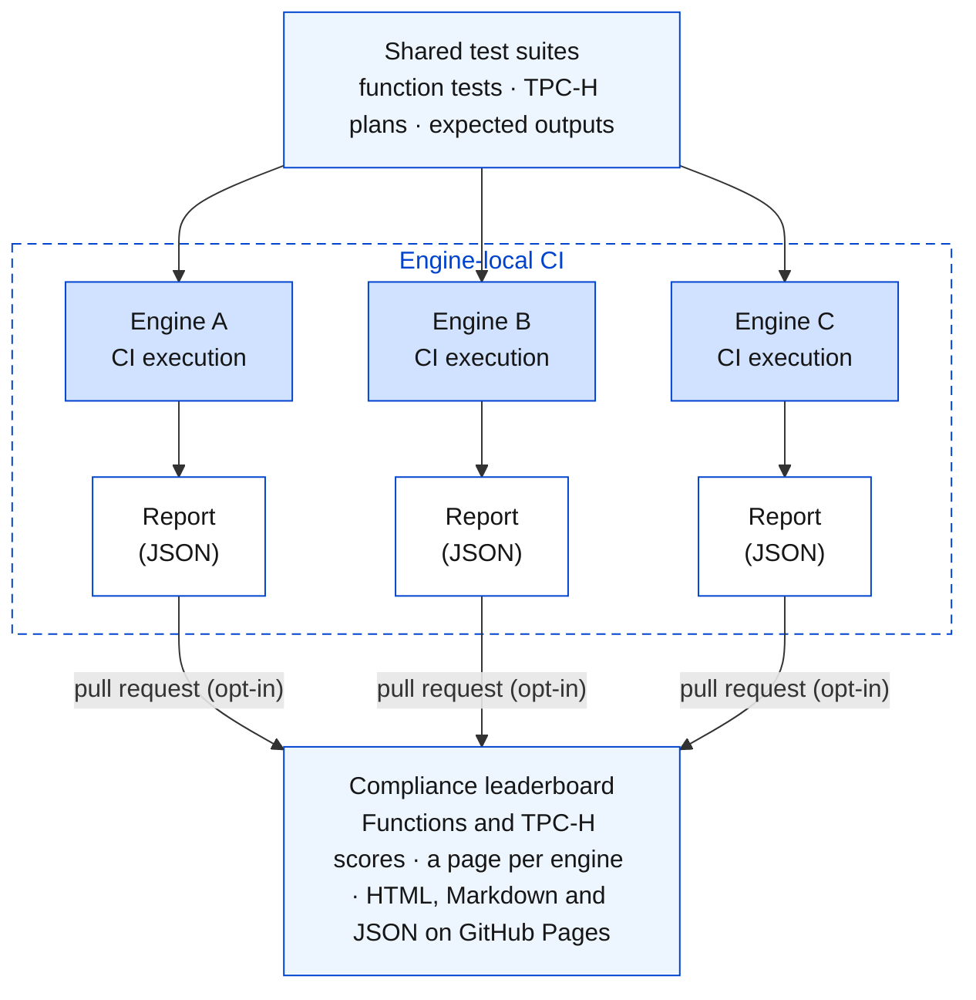
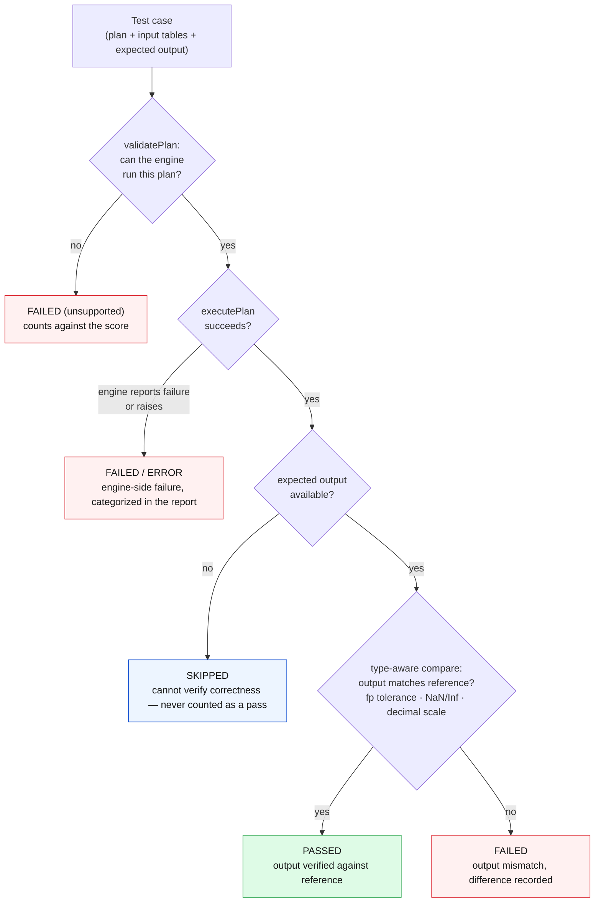

# The Substrait Compliance Framework

This document explains why plan-level interoperability needs verification, how the framework works, how to start using it, and where help is most useful.

---

## 1. The problem: parsing is not executing

[Substrait](https://substrait.io/) is a portable intermediate representation for relational algebra. A dataframe library, a SQL front end, or an automated planner produces a plan once, and any engine with a Substrait consumer, such as DuckDB, DataFusion or Velox, can execute it, without a custom connector for each pairing.

A standard fixes the syntax of the boundary between components. It does not fix the semantics. An engine can accept a Substrait plan, execute it without error, and return different rows than another conforming engine would. SQL has the same problem: a shared language does not imply shared behavior, because casting rules, null propagation, overflow handling, and function definitions all differ between implementations. Moving the contract from query text to the plan removes most parsing-level ambiguity; the semantic gap remains.

This repository's own runs show the failure mode. As of DuckDB 1.5.6 and DataFusion 55.0.0, run through their Substrait consumers, both engines replace only the first match in regexp_replace: replacing [bc] with dd in 'abcabcabc' gives 'addcabcabc', where the Substrait test case expects every match replaced, 'addddaddddadddd'. DuckDB's extract of the milliseconds of 01:02:03.155 returns 3155 where the Substrait test case expects 155, and its atanh(-1.0) returns +∞ instead of −∞. Each of these plans is valid and runs without error; only comparing the results catches the difference.

Divergence is also getting more expensive. Composable stacks chain producers, rewriters and engines developed independently, so an error at one boundary flows into results nobody inspects row by row. And plans are increasingly composed by programs, which, unlike an analyst, do not question a suspicious number. If plans cross engine boundaries routinely, semantic equivalence must be verified, not assumed.

## 2. Why decentralized

The usual answer to conformance is a certifying authority that runs a canonical suite against every implementation. That model does not fit this ecosystem.

Engine teams often cannot send proprietary builds, internal traces or customer data to an outside validator. Engines ship continuously, so conformance has to run in each team's own CI, not through a periodic certification queue. A compliance failure can reveal implementation details a company does not intend to publish, so teams must be able to take part while keeping diagnostics private. And a certified/not-certified verdict is too coarse: a planner deciding where to send a plan needs to know which categories of operations an engine handles correctly, not whether it cleared one bar.

The framework therefore inverts the model. The test corpus is shared and versioned. Execution happens inside each engine's own environment. Reporting is federated, and each team decides what it publishes. Compliance verification becomes one more reusable component in the composable stack.

## 3. Architecture

Three layers, mirroring the modular structure of the systems under test.



Shared suites run decentralized: locally, inside each engine's own CI pipeline (the dashed region), with no data leaving the engine team's environment. Structured reports feed a public leaderboard, published as HTML, Markdown and JSON, that scores each engine and gives it a page listing what fails and why. The figure adapts Figure 1 of the SAO 2026 paper, ending at the leaderboard; section 4 describes downstream consumers of the evidence, such as plan routers.

The first layer is the shared corpus, a versioned and language-neutral set of correctness fixtures, pinned to a Substrait release (currently 0.107.0):

| Suite | Cases | Source | On the leaderboard |
|---|---:|---|---|
| Functions | 1,315 | The Substrait project's own function test cases, with 55 documented fixes | Scored |
| TPC-H | 22 | The TPC-H queries as Substrait plans, binary and JSON, with expected outputs | Scored |
| Extended functions | 2,278 | Converted from the project's earlier suite and verified | Reference |

The function cases cover arithmetic (with decimal and unsigned subfamilies), rounding, logarithmic, boolean, comparison, datetime, string, list, aggregate and window functions. Each calls one function with typed arguments, often at an edge (nulls, boundaries, overflow, empty groups), and states the expected result; options such as overflow handling or rounding mode are part of the case. CI checks every case against the function definitions. Result correctness is verifiable end to end. None of this measures speed: these are semantic-fidelity tests, and the only question they answer is whether an engine returns the right rows.

The extended cases come from the project's earlier suite of 5,041 cases, part of which was generated with the LLM-assisted tools in scripts/. Converting it to the current format kept 2,278 cases: each matches a signature in the 0.107.0 function definitions, and its expected result was reproduced by DuckDB (2,151 cases) or computed from the definitions (127). 89 cases were dropped because their expected value contradicted the definitions. Because DuckDB's agreement is one of the two checks, these cases lean towards DuckDB's behavior, which is why the leaderboard does not score them.

The second layer is engine-local execution. SDKs exist in eight languages: Java, Python, Rust, Go, C++, TypeScript, C#, and Scala. Each exposes an idiomatic form of the same contract, and everything runs in the engine team's own environment and CI. No data leaves it.

The third layer is federated reporting. Each run produces a structured report: the engine and its version, totals, and each case that did not pass, with the reason. A team can keep its reports private or submit them to the leaderboard by pull request, where a check validates them against the current suites before anything is published. What leaves the engine's environment is that report of outcomes, never the engine, its data or its internal traces. That separation lets proprietary engines participate. This repository's own CI also runs two engines, DuckDB and Apache DataFusion, weekly and whenever the suites or runners change, so the leaderboard has reference results from the start.

## 4. The engine contract

Integrating an engine means implementing one interface. The Java SDK defines it as follows, and the other seven languages express the same contract in their own idiom (abstract base classes in Python, traits in Rust, and so on):

```java
public interface ComplianceEngine {
    EngineInfo getEngineInfo();               // name, version, vendor
    EngineCapabilities getCapabilities();     // supported relations, functions, types
    PlanValidationResult validatePlan(Plan plan);
    ComplianceResult executePlan(Plan plan, Map<String, TableData> inputData);
    default void initialize() { }             // once per suite, before any test
    default void cleanup()    { }             // once per suite, after all tests
}
```

Two methods return metadata. The other two do the work: validatePlan reports whether the engine can run the plan, and executePlan runs the plan against the provided input tables and returns tabular results. The framework's comparator verifies those results against the expected output using type-aware equality, which covers floating-point tolerance, NaN and Infinity semantics, and decimal scale handling.

Every test ends as passed, not passed (failed, error, or unsupported), or skipped, and the pass rate is passed ÷ (total − skipped). The distinction matters. A plan the engine cannot run counts against it, even when the engine declares it unsupported: the engine is not compliant with that plan, so declaring things unsupported never raises a score. Skipped means the case does not apply: it pins an option mode the engine does not claim (engines need implement only one mode of an option such as overflow handling), its expected result is undefined by the specification, this repository's tooling cannot express the case yet, or there is nothing to check the output against. A test whose expected output is unavailable is skipped, never passed. A pass always means the output matched a reference; it never means the plan merely ran without crashing. The rule is pinned by shared test vectors that every SDK reads, so an in-house score means the same as the leaderboard's.

The SDK runners classify each test case through a fixed decision sequence. The Python runners behind the leaderboard drive the engine directly instead of calling validatePlan, but score by the same rule:



The leaderboard reports pass rates and groups each engine's failures by cause. The papers below take the evidence further, in directions not yet implemented. Fidelity tiers would summarize an engine's results per category by how far its passing cases go: none, basic (nominal inputs pass), edge (standard edge cases such as nulls and empty groups pass too) or verified (the full category passes, including overflow). Capability contracts would put those tiers to work before execution: a plan states the operators, functions, types and tier it needs, each component advertises what it has measured, and a conservative check either confirms that a chain of components is safe for the plan or names the boundary that falls short, treating unknown coverage as unsafe. The same corpus would also support differential testing, running each plan on every engine that declares support and flagging any disagreement; that needs no reference output and localizes a fault to a specific boundary.

## 5. Getting started

Start with the [leaderboard](https://ibm.github.io/substrait-compliance/): each engine's page shows its scores and what fails, grouped by cause. The README covers the rest: [running the suites locally](../README.md#try-it-locally), [adding an engine to the leaderboard](../README.md#add-your-engine-to-the-leaderboard) through the Python runners and a pull request, and [which route to use](../README.md#which-route-do-i-use) if you would rather test inside your engine's own test suite with a [language SDK](../sdk/README.md). Reference integrations for DuckDB, DataFusion and Velox are in [examples/](../examples/README.md).

For CI there is a template workflow, .github/workflows/engine-compliance-template.yml. Set four variables (engine name, version, minimum pass-rate threshold, and the framework version to pin) and fill in the steps marked CUSTOMIZE THIS that build your engine and run the suites. It then runs weekly and on demand (add a push trigger to run it on every commit), fails if compliance drops below your threshold, and checks the framework out at a pinned release tag, so your compliance target stays stable across framework releases.

## 6. What the framework provides

For an engine team, the immediate return is a regression gate for semantic correctness. Function reports give results by category and TPC-H reports by query, and each engine's page groups its failures by cause, down to the individual case. It is a feedback loop that takes an integration toward full compliance one commit at a time.

For plan producers and platform builders, the published results show which function categories and queries each engine handles correctly: the evidence a router needs to decide where a plan can safely run.

The Substrait project benefits too. A case on which engines disagree with the specification, or with each other, points either to an engine bug or to a gap in the specification. For example, the comparison definitions say only that equal(x, y) is x == y; DuckDB 1.5.6 and DataFusion 55.0.0 both treat NaN as equal to itself, which IEEE 754 does not, so the specification leaves that case open. Checking the upstream function cases against the function definitions has already produced 55 documented fixes, where an upstream case contradicts the definitions, for reporting upstream.

## 7. Contributing

The framework's value comes from the engines that run it and the corpus they run against. Contributions expand both.

Running the suite against a production engine is the most valuable contribution. Implement the interface, run the suites, and report how it went. A published compliance report is ideal; an issue describing integration friction or a discussion post is also useful.

Test cases are welcome at any scale. Function cases use the Substrait project's own test format, so a good case can go upstream as well as here; query expected outputs are a documented, typed CSV (headers like revenue:double; see [test-suites/tpch/README.md](../test-suites/tpch/README.md)). Edge cases pulled from production bug trackers are especially valuable, because a defect observed in one engine tends to reproduce in others.

Specification ambiguities deserve reports of their own. If a test's expected value looks wrong because the Substrait specification admits more than one reading, open an issue with the case. A disputed semantic is not noise; it is one of the project's intended products.

SDK and example work is open in all eight languages: idiomatic improvements, additional suite loaders, and deeper reference integrations.

Questions and proposals go to [GitHub Discussions](https://github.com/IBM/substrait-compliance/discussions). Issues are triaged, and contribution guidelines are in [CONTRIBUTING.md](../CONTRIBUTING.md).

## 8. Further reading

Two workshop papers develop the design. "Trust at the Seams: Differential, Decentralized Compliance for Composable Query Engines" (CDMS Workshop at VLDB 2026) covers the composability argument, capability contracts, and differential testing. "Parsing Is Not Executing: Decentralized Compliance for Agentic Query Plan Routing" (SAO Workshop at ACM CAIS 2026) covers evidence-based plan routing. In the repository: the [README](../README.md) for an overview and quick start, [how engines are scored](COMPLIANCE_LEADERBOARD.md), the [test suites](../test-suites/README.md), [submitting results](../submissions/README.md), and the [language SDKs](../sdk/README.md).

Substrait standardizes the syntax of the plan boundary. Whether two implementations mean the same thing by the same plan is a separate question, and only measurement can answer it. This framework answers it from inside each engine's own CI.
